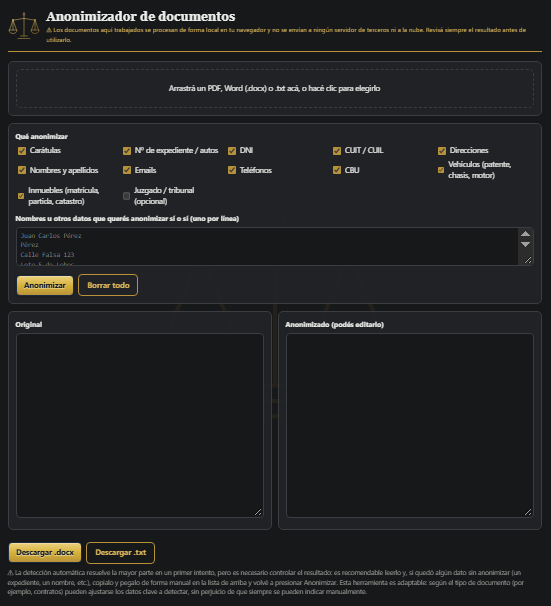

# ⚖️ Anonimizador de documentos

Herramienta web estática para anonimizar documentos (judiciales, contratos, informes, sucesiones, etc.) en pocos pasos. Se abre en el navegador, sin instalar nada.



## Qué hace

1. Cargás un **PDF**, un **Word (.docx)** o un **.txt**.
2. Elegís qué datos anonimizar.
3. Revisás el resultado, que podés editar.
4. Descargás el documento anonimizado en **.docx** o **.txt**.

Al terminar muestra un **resumen** de lo reemplazado (por ejemplo, cantidad de personas, DNI y expedientes).

## Qué detecta

- Carátulas y números de expediente (expte., causa, CUIJ, SAC, legajo, autos, o el número suelto con formato `12345/2025`)
- DNI y CUIT/CUIL
- Nombres y apellidos (patrones como `APELLIDO, Nombre` o `Sr./Dra. Nombre`)
- Direcciones
- Emails, teléfonos y CBU
- Vehículos: patentes (formato viejo `AAA123` y Mercosur `AB123CD`), chasis y motor
- Inmuebles: matrícula, partida, nomenclatura catastral
- Juzgado o tribunal (opcional, desactivado por defecto: cada usuario decide si es un dato relevante)
- Cualquier dato que agregues en la **lista manual** (uno por línea)

## Pensado para un uso concreto

Esta herramienta está **hecha a medida para mis usos**: la diseñé pensando en los documentos con los que trabajo (documentos judiciales, contratos, informes y sucesiones) y en los datos que en ellos suele ser necesario anonimizar. Por eso las reglas de detección responden a esos casos.

Esto significa que **no va a anonimizar todo**: la detección automática resuelve la mayor parte, pero siempre hay que controlar el resultado e indicar de forma manual los datos que falten.

Sin perjuicio de eso, **podés usarla y complementarla manualmente** con la lista de datos a anonimizar. Y si el proyecto te gusta y querés usarlo con otros tipos de documento, **podés adaptarlo**: los patrones de detección están en `app.js` (función `anonymize`) y se pueden editar para sumar, quitar o cambiar los datos clave que te interesen.

## Privacidad

Todo el procesamiento ocurre **localmente en tu navegador**. El documento no se envía a ningún servidor de terceros ni a la nube. La página solo descarga las librerías de lectura (PDF.js, Mammoth y JSZip) desde un CDN.

## Limitaciones

- Es un **prototipo**: la detección se basa en patrones y no es infalible. La primera pasada resuelve la mayor parte, pero es **necesario controlar el resultado**: es recomendable leerlo y, si quedó algún dato sin anonimizar (por ejemplo un expediente o un nombre), **copialo y pegalo de forma manual en la lista** (uno por línea) y volvé a presionar *Anonimizar*.
- El resultado se genera como texto, por lo que **no conserva el formato original** (tablas, negritas, encabezados).
- Los **PDF escaneados** (imágenes) necesitan OCR previo.
- No reemplaza el criterio profesional ni las obligaciones legales de protección de datos personales.

## Uso

Descargá los archivos en la misma carpeta y abrí `index.html` con doble clic, o publicalo con GitHub Pages (*Settings → Pages*).

## Estructura

```
index.html   → estructura de la página
styles.css   → estilos y diseño
app.js       → lógica de lectura, detección, resumen y descarga
assets/      → capturas de pantalla (anonimizador.png)
```

> No subas a este repositorio documentos reales ni ejemplos con datos verdaderos.
